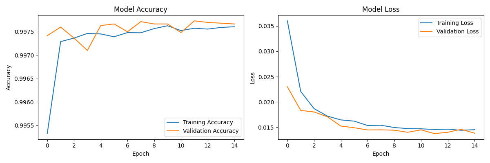

# Hybrid IDS for IoMT Devices

A deep learning–based **Intrusion Detection System (IDS)** for **Internet of Medical Things (IoMT)** devices, built on the [CIC IoMT 2024 dataset](https://www.unb.ca/cic/datasets/iomt-dataset-2024.html). The system detects and classifies network attacks against connected medical devices — a domain where a missed intrusion can directly endanger patient safety.

Developed as my Computer Engineering **senior thesis project** at Karadeniz Technical University.

## Why IoMT Security?

Connected medical devices (patient monitors, infusion pumps, wearables) are increasingly targeted by network attacks, yet they are too resource-constrained to run heavy endpoint security. A network-level IDS that recognizes malicious traffic patterns is one of the few practical defenses. This project explores how well a hybrid deep learning pipeline can separate benign IoMT traffic from 18 different attack subtypes.

## Hybrid Architecture

The "hybrid" design combines two complementary deep learning components:

1. **Autoencoder feature extraction** — a bottleneck autoencoder (128 → 32 → 128) compresses the raw network-flow feature space into a dense 32-dimensional representation, filtering noise and redundancy before classification.
2. **Bidirectional LSTM + Attention classifier** — the encoded features are reshaped into sequences and processed by a BiLSTM (64 units, both directions), followed by a **custom attention mechanism** (Dense + Softmax weighting over time steps) that lets the model focus on the most informative parts of each flow, then a dense classification head.

```
CSV network flows (CIC IoMT 2024)
        │
        ▼
Cleaning → dedup, NaN/Inf handling → RobustScaler
        │
        ▼
Class balancing → per-class sampling + SMOTE (train set only)
        │
        ▼
Autoencoder (128 → 32 → 128) → compact 32-dim features
        │
        ▼
Bidirectional LSTM (64) → custom Attention → GlobalAveragePooling
        │
        ▼
Dense head → Softmax (multi-class) / Sigmoid (binary)
```

**Training details:** class-weight balancing with square-root scaling for imbalanced classes, gradient clipping (`clipnorm=1.0`), early stopping, `ReduceLROnPlateau`, and model checkpointing of the best weights.

## Dataset

- **Source:** CIC IoMT 2024 — Canadian Institute for Cybersecurity, University of New Brunswick
- **Content:** benign IoMT traffic + **18 attack subtypes** across 5 attack families:

| Family | Subtypes |
|---|---|
| DDoS (TCP/IP) | ICMP, SYN, TCP, UDP floods |
| DoS (TCP/IP) | ICMP, SYN, TCP, UDP floods |
| MQTT attacks | DDoS Connect/Publish Flood, DoS Connect/Publish Flood, Malformed Data |
| Reconnaissance | OS Scan, Ping Sweep, Port Scan, Vulnerability Scan |
| Spoofing | ARP Spoofing |

- **Split:** 60 / 20 / 20 stratified train / validation / test.
- Dataset files are **not** committed to this repo (size). See [README_DATA.md](README_DATA.md) for the expected `data/train/` and `data/test/` layout and download instructions.

## Classification Modes

The pipeline supports three granularities via `--class_config`:

| `--class_config` | Classes | Use case |
|---|---|---|
| `2`  | Attack vs. Benign | fastest, deployment-style binary alarm |
| `6`  | Benign, DDoS, DoS, MQTT, Recon, Spoofing | attack-family triage |
| `19` | benign + all 18 subtypes | fine-grained forensics |

## Evaluation

Every run produces a full set of per-class evaluation artifacts (included in [`src/`](src/)):

- Normalized **confusion matrix** — [`confusion_matrix.png`](src/confusion_matrix.png)
- **Per-class ROC curves** with AUC — `roc_curve_*.png`
- **Per-class precision-recall curves** — `pr_curve_*.png`
- **Training history** (accuracy / loss / precision / recall) — [`training_history.png`](training_history.png)



## Project Structure

```
├── src/
│   ├── data_loader.py   # loading, cleaning, class mapping, SMOTE, autoencoder features
│   ├── model.py         # BiLSTM + attention architecture
│   ├── main.py          # CLI entry point: train + evaluate + plots
│   ├── best_model.h5    # best checkpoint
│   ├── final_model.h5   # final trained model
│   └── *.png            # per-class ROC / PR curves, confusion matrix
├── data/                # CIC IoMT 2024 CSVs (not committed — see README_DATA.md)
├── README_DATA.md       # dataset layout & download instructions
├── requirements.txt
└── README.md
```

## Getting Started

```bash
git clone https://github.com/MehmetAli20/Hybrid-IDS-for-IoMT-Devices.git
cd Hybrid-IDS-for-IoMT-Devices
pip install -r requirements.txt

# download CIC IoMT 2024 CSVs into data/train and data/test (see README_DATA.md)

# train & evaluate — pick classification granularity (2, 6, or 19)
python src/main.py --class_config 6 --epochs 50 --batch_size 512 --max_samples 100000
```

| Argument | Default | Description |
|---|---|---|
| `--class_config` | `2` | Classification granularity: 2, 6, or 19 classes |
| `--epochs` | `50` | Training epochs |
| `--batch_size` | `512` | Training batch size |
| `--max_samples` | `100000` | Max samples per class (memory control) |

## Tech Stack

Python · TensorFlow/Keras · scikit-learn · imbalanced-learn (SMOTE) · NumPy · Pandas · Matplotlib

## Possible Improvements

- Benchmark against classical ML baselines (Random Forest, XGBoost) on the same splits
- Real-time inference on live packet captures (e.g., via CICFlowMeter feature extraction)
- Model compression (quantization/pruning) for edge deployment near IoMT gateways
